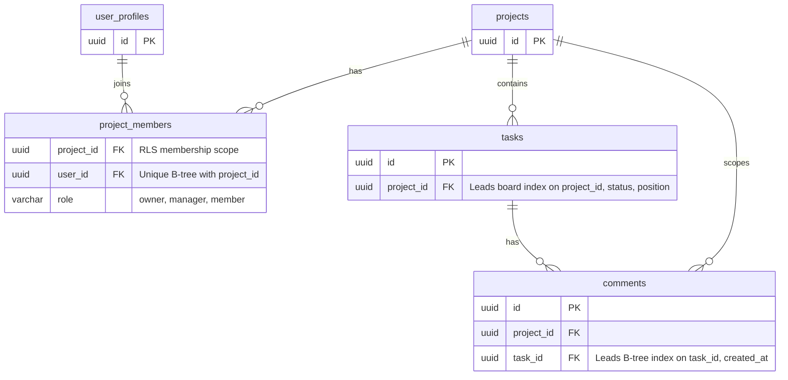

# ProjectForge

ProjectForge gives software teams a shared board for assigning tasks, tracking time, and reviewing project costs. A person can own one project and be a member of another, so every task edit and role change depends on their membership in the selected project.

**My contribution.** I’m Aashwat Singh. On this UT Dallas team project, I owned task assignment, project membership, and collaboration across the Python API and React client. One failure case worth reading is what happens when two owners demote each other at the same time. [Member routes](backend/app/routers/members.py) · [Task board](web/src/pages/BoardPage.tsx) · [Database regression tests](backend/tests/test_supabase_rls.py)

## Data model and access control

A project is the tenant boundary. The diagram follows a task from the board to its comments and shows where membership and role are stored.



## Key engineering decisions and trade-offs

- **Store the role on the membership.** A unique constraint on `(project_id, user_id)` prevents duplicate memberships and supports the lookup used for authorization. A separate B-tree on `(project_id, status, position)` matches the board’s sort order. Each index adds work when its columns change. [Schema and indexes](supabase/migrations/0001_initial_schema.sql)
- **Check both access paths.** The Python API checks the caller’s current role on each protected request because its database connection can bypass RLS. For direct Supabase clients, PostgreSQL row-level security enforces project membership. Keeping those two paths consistent requires tests at both boundaries. [API permissions](backend/app/core/permissions.py) · [Database tests](backend/tests/test_supabase_rls.py)
- **Serialize changes that could remove the last owner.** Two demotions can each see another owner before either transaction commits. The membership trigger locks the project row before checking how many owners remain. Changes to the same project can wait on that lock. [Hardening migration](supabase/migrations/0002_security_hardening.sql)
- **Keep AI outside the access decision.** The team scoped the assistant out of the public build. Task assignment, role changes, and access to costs use explicit rules that a reviewer can exercise locally. For a Nemotron integration, the same project permissions would have to bound any data sent to the model. [Team scope and decisions](docs/fullstack-mvp/README.md)

## Local setup

Use Python 3.11+ and Node.js 18+. The local demo seeds a SQLite database on first launch. Run these commands in PowerShell.

**Terminal 1 — API**

```powershell
git clone https://github.com/aashwatSingh/ProjectForge-Personal.git
cd ProjectForge-Personal/backend
python -m venv .venv
.\.venv\Scripts\python.exe -m pip install -r requirements.txt
.\.venv\Scripts\python.exe -m uvicorn app.main:app --reload --port 8000
```

**Terminal 2 — web client**, starting at the repository root

```powershell
cd web
npm ci
npm run dev
```

Open `http://localhost:5173` and sign in with the **Jon** demo account shown on the login screen. In **ProjectForge Platform**, open **Cost** as Jon, then use the sidebar switcher to view the same project as **Staff**. Jon can read the budget. Staff gets an access-denied response. The API reports the active database at `http://localhost:8000/api/health`.

### `backend/.env.example`

These are the settings for the local demo. The backend reads `backend/.env`. [Full configuration example](backend/.env.example)

```dotenv
ENVIRONMENT=development
DATABASE_URL=
DB_FALLBACK_TO_SQLITE=true
JWT_SECRET=
DEMO_MODE=true
SEED_DEMO_DATA=true
```

**To exercise PostgreSQL policies**, use a development Supabase database. Apply the [initial schema](supabase/migrations/0001_initial_schema.sql) and then the [hardening migration](supabase/migrations/0002_security_hardening.sql). Set `DATABASE_URL` to the database connection string in `backend/.env` and set `DB_FALLBACK_TO_SQLITE=false`. Restart the API and check that `/api/health` reports `postgresql`. The SQLite demo exercises the API’s role checks. Direct-client RLS requires PostgreSQL.

## Verify it

From `backend/`, run `.\.venv\Scripts\python.exe -m pytest` for the default backend suite. To include the direct database tests, set `SUPABASE_TEST_DB_URL` in the shell to a disposable PostgreSQL server where the test user can create databases and roles. The suite creates its own test database, applies the migrations, and checks cross-project access and concurrent role changes. From `web/`, run `npm test` for client tests and `npm run build` for the production build.

## Team and contributor guide

UT Dallas CS 3354, Team 3 — Jon Sorey, Tyler Gaines, Preethi Seereddy, Saaqib Shaik, Myoram Langwang, and Aashwat Singh.

**Start here for changes.** Read the full team brief before planning or writing code. It keeps the project’s requirements, ownership, conventions, and open decisions together. [Team brief](docs/fullstack-mvp/README.md) · [Implementation handoff](docs/fullstack-mvp/TEAM_HANDOFF.md) · [Original requirement-to-test matrix](https://github.com/aashwatSingh/ProjectForge-Personal/blob/c41a4bea6720a560e921e296cf4e39b431650190/README.md#requirement-traceability)
